# Multi-Agent Engineering Roadmap (20 Agents for Issues #72–#91)

This document formalizes the division of engineering responsibilities, architectural invariants, interface contracts, and acceptance criteria across **20 specialized autonomous agents**, covering all open GitHub issues ([#72 to #91](https://github.com/abanach-com/rust-discord-bot/issues)) for the **Rusty Discord Bot (`rusty-discord-bot`)** platform.

---

## 1. Global Architectural Invariants

Every agent must operate strictly within the following privileged boundary rules:

1. **Rust is the Privileged Host**: Direct Discord API calls, PostgreSQL transactions, Songbird voice operations, filesystem access, process execution, and network egress belong exclusively to the Rust host.
2. **Lua Sandbox Boundary**: Lua scripts never receive bot tokens, database connection pools, or direct OS handles. Lua returns declarative action payloads to Rust, which performs validation, permission checks, hierarchy verification, rate limiting, and auditing.
3. **Snowflake Precision**: Discord IDs (guild, channel, role, user, message) must always be serialized and transferred as `String` across Lua, JSON, PostgreSQL, and dashboard boundaries to prevent 64-bit integer truncation.
4. **Hierarchy Checks**: Any action modifying roles, permissions, or executing moderation sanctions must verify both:
   - The bot's highest role is strictly above the target member/role.
   - The invoking actor's highest role is strictly above the target member/role.
5. **Defense-in-Depth & Uncontrolled Mentions**: Generated messages and embeds must have `@everyone`, `@here`, and role mentions escaped by default via `escape_mentions`.
6. **Optimistic Concurrency & Transactional Ledgers**: State mutations (economy balances, ticket lifecycle, moderation case updates, giveaways) must utilize database row-level locking (`SELECT ... FOR UPDATE`) or version checks to eliminate race conditions.

---

## 2. Execution Phases & Dependency DAG

```mermaid
flowchart TD
    subgraph Phase1["Phase 1: Security, Governance & Administration (P1)"]
        A01["Agent 01: Core Architecture & Roadmap (#72)"]
        A02["Agent 02: Admin Dashboard & Permissions (#73)"]
        A03["Agent 03: Moderation Appeals & Escalation (#74)"]
        A04["Agent 04: Server Defense & Anti-Raid (#75)"]
        A05["Agent 05: Onboarding & Timed Roles (#76)"]
        A06["Agent 06: Support Desk & Modmail (#77)"]
        
        A01 --> A02
        A01 --> A03
        A01 --> A04
        A01 --> A05
        A01 --> A06
    end

    subgraph Phase2["Phase 2: Platform, Automation, Media & Community (P2)"]
        A07["Agent 07: Disaster Recovery & Snapshots (#78)"]
        A08["Agent 08: Custom Commands & Triggers (#79)"]
        A09["Agent 09: Lua SDK & Multi-Worker (#80)"]
        A10["Agent 10: Announcements & Member Tools (#81)"]
        A11["Agent 11: Polls, Giveaways & Starboard (#82)"]
        A12["Agent 12: Leveling, Economy & Store (#83)"]
        A13["Agent 13: Events, LFG & Tournaments (#84)"]
        A14["Agent 14: Telemetry & Invite Tracking (#85)"]
        A15["Agent 15: Audio Streamer & DJ (#86)"]
        A16["Agent 16: Voice on Demand & Stage (#87)"]
        A17["Agent 17: Feed Aggregator & Webhooks (#88)"]
        
        A02 --> A07
        A02 --> A08
        A02 --> A09
        A05 --> A10
        A05 --> A11
        A03 --> A12
        A06 --> A13
        A04 --> A14
        A09 --> A15
        A09 --> A16
        A08 --> A17
    end

    subgraph Phase3["Phase 3: Ecosystem Bridges, RP & AI Assistance (P3)"]
        A18["Agent 18: Game Bridges (Steam/MC/PoE) (#89)"]
        A19["Agent 19: Turn-Based Games & RP (#90)"]
        A20["Agent 20: Knowledge Base & RAG Assistant (#91)"]
        
        A09 --> A18
        A12 --> A19
        A06 --> A20
    end
```



---

## 3. Specifications for the 20 Autonomous Agents

### Agent 01: Core Architecture & Roadmap Orchestrator
- **GitHub Issue**: [#72 `[Roadmapa] ZuckerBot — katalog funkcji, porównanie botów Discorda i plan wdrożenia`](https://github.com/abanach-com/rust-discord-bot/issues/72)
- **Priority**: P1 (Master Coordinator)
- **Domain Mission**: Maintains system-wide integrity, master documentation (`docs/FEATURE_MATRIX.md`, `docs/ARCHITECTURE.md`), version synchronization (`docs/VERSION_POLICY.md`), and coordinates cross-agent contract changes.
- **Key Files**:
  - `docs/FEATURE_MATRIX.md`
  - `docs/ARCHITECTURE.md`
  - `docs/DISCORD_PLATFORM_COVERAGE.md`
  - `src/lib.rs`, `src/state.rs`
- **Invariants**: Ensures that all 26+ modular Lua packages maintain strict parity with `scripts/install.xml` and host runtime versions.
- **Acceptance Scenarios**:
  1. The 19 modular tracks (#73–#91) compile cleanly under pinned stable Rust and pass full CI audit.
  2. All feature matrices and platform coverage docs accurately reflect runtime state.

---

### Agent 02: Admin Dashboard, Module Supervisor & RBAC
- **GitHub Issue**: [#73 `[Funkcje] Panel administratora, instalacja modułów i uprawnienia zespołu`](https://github.com/abanach-com/rust-discord-bot/issues/73)
- **Priority**: P1
- **Domain Mission**: Setup wizard, diagnostic permission inspector (bot hierarchy & missing intents), team roles (Owner, Admin, Mod, Support, Observer), draft vs. published configs with SSE conflict resolution.
- **Key Files**:
  - `src/web/mod.rs`, `src/web/routes.rs`, `src/web/auth.rs`
  - `web/static/app.js`
  - `src/storage/mod.rs`, `src/storage/postgres.rs`
- **Invariants**: Dashboard routes enforce server-side guild permission checks (`ensure_guild_access`). SSE updates from other modules must never wipe uncommitted local form state.
- **Acceptance Scenarios**:
  1. A user with Support role accesses only the ticket module; forbidden from modifying bans or other guild configs.
  2. Test server setup warns of missing `MANAGE_ROLES` permission and highlights bot role position before retry succeeds.

---

### Agent 03: Moderation Appeals, Escalation & Event Audit Log
- **GitHub Issue**: [#74 `[Funkcje] Moderacja: odwołania od sankcji, eskalacja i dziennik zdarzeń`](https://github.com/abanach-com/rust-discord-bot/issues/74)
- **Priority**: P1
- **Domain Mission**: Complete appeal lifecycle for bans/mutes (even after guild departure), warning point escalation rules, staff private notes separation, dedicated logging channels per event type.
- **Key Files**:
  - `scripts/moderation/module.lua`, `scripts/moderation/config.json`
  - `src/moderation_cases/model.rs`, `src/moderation_cases/postgres.rs`
  - `src/discord/moderation_cases.rs`
  - `docs/MODERATION_CASES.md`, `tests/moderation_cases.rs`
- **Invariants**: Banned users can authenticate via OAuth2 to view only their own cases and submit appeals. Private staff notes are permanently stripped from user-facing views and exports.
- **Acceptance Scenarios**:
  1. Banned user views case #123 and files an appeal; attempts to access another user's case or guild return 403 Forbidden.
  2. Concurrent approval of the same appeal by two moderators results in a single unban action with optimistic locking.

---

### Agent 04: Server Defense, AutoMod Simulator & Anti-Raid Guard
- **GitHub Issue**: [#75 `[Funkcje] Ochrona serwera: symulator AutoMod, wykrywanie rajdów i weryfikacja`](https://github.com/abanach-com/rust-discord-bot/issues/75)
- **Priority**: P1
- **Domain Mission**: Sliding window spam scoring, multi-channel pattern detection, raid burst detection, simulation dry-run mode, phased lockdown (alarm -> verification -> quarantine -> slowmode).
- **Key Files**:
  - `scripts/automod/module.lua`, `scripts/join_guard/module.lua`
  - `src/discord/handler.rs`, `src/discord/executor.rs`
  - `tests/discord_isolation_and_hierarchy.rs`
- **Invariants**: Simulator executes zero Discord API mutations. Unlocking channels restores exact pre-lockdown permission overrides while flagging manual moderator interventions.
- **Acceptance Scenarios**:
  1. A simulated attack string yields identical rule hits in test simulation and live dry-run mode without issuing Discord bans.
  2. Sudden influx of 50 accounts in 10 seconds triggers raid shield; quarantine blocks welcome autorole until verification is passed.

---

### Agent 05: Onboarding, Dynamic Roles & Timed Role Hierarchy
- **GitHub Issue**: [#76 `[Funkcje] Powitania i role: ścieżki wejścia, panele wyboru i role czasowe`](https://github.com/abanach-com/rust-discord-bot/issues/76)
- **Priority**: P1
- **Domain Mission**: Multi-step onboarding flows (rules accept -> language -> interests), self-assign role panels (buttons/menus) with mutual exclusion / prerequisite rules, timed expiring roles with safe renewal.
- **Key Files**:
  - `scripts/welcome/module.lua`, `scripts/roles/module.lua`, `scripts/reaction_roles/module.lua`
  - `src/scheduler/mod.rs`, `src/discord/executor.rs`
- **Invariants**: Bot cannot assign roles equal to or above its highest role. Expiring role tasks check generation timestamps so renewed roles are not prematurely stripped by obsolete background tasks.
- **Acceptance Scenarios**:
  1. User selecting mutually exclusive roles via button panel receives strictly one role after rapid double-click.
  2. Member leaves and rejoins: only roles flagged for persistence are restored; temporary role expired while absent is skipped.

---

### Agent 06: Helpdesk, Modmail & Ticket Operations
- **GitHub Issue**: [#77 `[Funkcje] Wsparcie: formularze zgłoszeń, Modmail i praca zespołów`](https://github.com/abanach-com/rust-discord-bot/issues/77)
- **Priority**: P1
- **Domain Mission**: Multi-department ticket panels with modal forms, Modmail bridge (DM -> private thread/channel), staff shifts, SLA first-response timers, inactivity closing, safe HTML/JSON transcripts.
- **Key Files**:
  - `scripts/tickets/module.lua`, `src/tickets/model.rs`, `src/tickets/postgres.rs`
  - `src/discord/tickets.rs`, `tests/tickets.rs`
- **Invariants**: Modmail sender with multiple shared guilds must select destination guild before routing. Internal staff notes are excluded from client transcripts and DMs.
- **Acceptance Scenarios**:
  1. Member replies to open ticket 1 minute prior to auto-close deadline; pending closure is cancelled immediately.
  2. Private ticket transcript exports HTML with strict sanitization, stripping scripts and raw bot credentials.

---

### Agent 07: Disaster Recovery, Server Snapshots & Controlled Restore
- **GitHub Issue**: [#78 `[Funkcje] Kopie struktury serwera: szablony, podgląd zmian i kontrolowane odtworzenie`](https://github.com/abanach-com/rust-discord-bot/issues/78)
- **Priority**: P2
- **Domain Mission**: Versioned server structure snapshots (categories, channels, permissions, roles, module settings), template export with PII/secret scrubbing, diff preview before restoration.
- **Key Files**:
  - `src/storage/mod.rs`, `src/discord/executor.rs`, `src/web/routes.rs`
  - `docs/ARCHITECTURE.md`
- **Invariants**: Templates scrub user IDs, messages, webhooks, and tokens. Restoration builds an ID remap table and maintains private channel visibility invariants during creation.
- **Acceptance Scenarios**:
  1. Snapshot restore to an empty test server recreates channel hierarchy and private category overrides with newly generated Discord snowflakes.
  2. Diff preview makes zero Discord changes; user cancels without altering server state.

---

### Agent 08: Custom Commands & Trigger-Action Automation Engine
- **GitHub Issue**: [#79 `[Funkcje] Własne komendy i automatyzacje z wyzwalaczami, warunkami i historią wykonania`](https://github.com/abanach-com/rust-discord-bot/issues/79)
- **Priority**: P2
- **Domain Mission**: Dashboard rule builder (event + condition + action), custom slash commands with arguments and aliases, sandboxed regex triggers, TTL variables, loop detection.
- **Key Files**:
  - `src/lua/engine.rs`, `src/lua/model.rs`
  - `scripts/tags/module.lua`, `src/discord/handler.rs`
- **Invariants**: Execution budget limits instruction count and call depth; cyclic triggers abort at maximum threshold. Only allowlisted Rust host actions are reachable.
- **Acceptance Scenarios**:
  1. Reaction rule awards role once; duplicate event receipt is recognized as idempotent and ignored.
  2. Mutually triggering rules terminate cleanly after hitting the depth limit without thread starvation.

---

### Agent 09: Lua SDK, Secure Module Directory & Multi-Worker Scaling
- **GitHub Issue**: [#80 `[Funkcje] SDK Lua, bezpieczny katalog modułów i utrzymanie instalacji wieloserwerowej`](https://github.com/abanach-com/rust-discord-bot/issues/80)
- **Priority**: P2
- **Domain Mission**: Complete UI component SDK (buttons, select menus, modals, autocomplete), signed module packages, version compatibility constraints, multi-process shard supervisor IPC.
- **Key Files**:
  - `src/lua/engine.rs`, `src/lua/install_xml.rs`, `src/metrics.rs`
  - `scripts/install.xml`, `docs/LUA_API.md`
- **Invariants**: Dynamic component `custom_id` encodes guild, action, user, and expiry timestamp. Stale or cross-guild component IDs are rejected by the host.
- **Acceptance Scenarios**:
  1. Updating a module requiring expanded permissions stays pinned to previous version until server administrator approves the delta.
  2. Worker failure in multi-shard mode does not lock other shard queues; dead lease is recovered by backup worker.

---

### Agent 10: Rich Announcements, Sticky Feeds & Member Utility Tools
- **GitHub Issue**: [#81 `[Funkcje] Ogłoszenia, stałe wiadomości, narzędzia członków i publikacja mediów`](https://github.com/abanach-com/rust-discord-bot/issues/81)
- **Priority**: P2
- **Domain Mission**: Visual embed builder with mobile preview, multi-channel broadcast with partial retry, sticky message keep-alive with rate-limit throttling, member user/server info cards.
- **Key Files**:
  - `scripts/staff_tools/module.lua`, `scripts/server_info/module.lua`, `scripts/utility/module.lua`
  - `src/discord/executor.rs`
- **Invariants**: Sticky message updates must respect channel rate limits (max 1 update per configured duration) and delete previous instances cleanly.
- **Acceptance Scenarios**:
  1. High chat velocity updates sticky message at most once within the cooldown window.
  2. Broadcast sent to 3 channels where 1 fails due to channel permissions reports 2 successes and 1 failure with granular retry button.

---

### Agent 11: Community Engagement: Polls, Giveaways & Starboard
- **GitHub Issue**: [#82 `[Funkcje] Dodać ankiety, losowania, głosowanie nad sugestiami i wyróżnienia społeczności`](https://github.com/abanach-com/rust-discord-bot/issues/82)
- **Priority**: P2
- **Domain Mission**: Weighted & anonymous polls, giveaway system with eligibility criteria and reroll capability, suggestion box with voting threads and moderator decisions, starboard with reaction thresholds.
- **Key Files**:
  - `scripts/community/module.lua`, `scripts/giveaway/module.lua`, `scripts/starboard/module.lua`
  - `src/storage/mod.rs`, `tests/community_suite.rs`
- **Invariants**: Anonymous poll votes cannot be correlated to user IDs in database or logs. Starboard excludes private/unauthorized channels from being posted to public boards.
- **Acceptance Scenarios**:
  1. Member changes vote in anonymous poll; tally updates correctly while preserving anonymity.
  2. Giveaway process restart during draw maintains deterministic winner list and allows audited replacement reroll.

---

### Agent 12: Leveling & Economy: Seasons, Server Store, Ledger & Bot Migration
- **GitHub Issue**: [#83 `[Funkcje] Rozszerzyć poziomy i ekonomię o sezony, sklep i import postępów`](https://github.com/abanach-com/rust-discord-bot/issues/83)
- **Priority**: P2
- **Domain Mission**: Voice and reaction XP (with AFK filters), seasonal leaderboards with historical archives, virtual item/role shop with transactional debit ledger, CSV/JSON progress importer (Kiai/Mee6).
- **Key Files**:
  - `scripts/progression/module.lua`, `scripts/economy/module.lua`
  - `src/storage/progression.rs`, `migrations/0002_progression.sql`, `tests/progression.rs`
- **Invariants**: Balance transfers and shop purchases execute inside PostgreSQL transactions with `FOR UPDATE` locks to prevent double-spending or negative balances.
- **Acceptance Scenarios**:
  1. Two members simultaneously buy the last inventory item; one succeeds, the other fails with funds unspent.
  2. Importing a Mee6 CSV export with duplicate rows validates cleanly, flags conflicts in preview, and imports idempotently.

---

### Agent 13: Events Calendar, Rosters, LFG & Tournament Brackets
- **GitHub Issue**: [#84 `[Funkcje] Dodać kalendarz wydarzeń, zapisy na skład, wyszukiwanie drużyn i turnieje`](https://github.com/abanach-com/rust-discord-bot/issues/84)
- **Priority**: P2
- **Domain Mission**: Scheduled events with IANA timezone support and DST safety, roster signups by role with reserve benches, expiring LFG posts, single-elimination tournament brackets.
- **Key Files**:
  - `scripts/scheduler/module.lua`, `scripts/games/module.lua`
  - `src/scheduler/mod.rs`, `src/discord/executor.rs`
- **Invariants**: Roster capacity is atomic; when an accepted participant leaves, the top qualified reserve member auto-promotes without duplicate slots.
- **Acceptance Scenarios**:
  1. Event scheduled for 19:00 Warsaw time retains local hour across DST transition; ICS export matches Discord timestamp.
  2. In an 8-team bracket, a verified match outcome advances the winning team without creating duplicate round pairings.

---

### Agent 14: Telemetry, Activity Analytics & Invite Tracking
- **GitHub Issue**: [#85 `[Funkcje] Dodać statystyki aktywności, retencję członków i źródła zaproszeń`](https://github.com/abanach-com/rust-discord-bot/issues/85)
- **Priority**: P2
- **Domain Mission**: Daily message and voice session aggregation with privacy anonymization, weekly cohort retention tracking, invite code attribution (campaign tags), CSV export.
- **Key Files**:
  - `src/storage/mod.rs`, `src/discord/handler.rs`, `src/metrics.rs`, `src/web/routes.rs`
- **Invariants**: Voice tracking tracks durations from gateway voice state updates while discarding AFK channel time. Private channels are excluded from aggregated stats.
- **Acceptance Scenarios**:
  1. Cohort retention calculates accurate percentages for members joining in week W active in week W+1.
  2. Member without Analytics role is restricted to standard aggregates; excluded channels never appear in reports.

---

### Agent 15: Audio Streamer, Queue Control & DJ Governance
- **GitHub Issue**: [#86 `[Funkcje] Muzyka i radio: widok kolejki, sterowanie DJ-a i zapisane playlisty`](https://github.com/abanach-com/rust-discord-bot/issues/86)
- **Priority**: P2
- **Domain Mission**: Paginated interactive queue view, DJ role enforcement, vote-skipping (listeners present on channel), personal/guild saved playlists, internet radio directory (ICY metadata).
- **Key Files**:
  - `src/discord/music.rs`, `scripts/music/module.lua`
  - `tests/music_egress.rs`
- **Invariants**: SSRF defense: music URLs must pass `MUSIC_ALLOWED_HOSTS` validation and resolve only to non-private, non-loopback IP addresses. Radio streams redirecting to internal IPs are rejected.
- **Acceptance Scenarios**:
  1. A user not in the voice channel cannot trigger pause or skip.
  2. Radio station redirecting to `127.0.0.1` or `169.254.169.254` is blocked at the egress resolver.

---

### Agent 16: Dynamic Voice, Stage Management & Conversation Accessibility
- **GitHub Issue**: [#87 `[Funkcje] Kanały głosowe na żądanie, obsługa Sceny i dostępność rozmów`](https://github.com/abanach-com/rust-discord-bot/issues/87)
- **Priority**: P2
- **Domain Mission**: Join-to-create temporary voice channels with automatic cleanup on empty, room owner controls, stage channel moderation (speaker requests), server soundboard management.
- **Key Files**:
  - `src/discord/handler.rs`, `src/discord/executor.rs`
  - `docs/DISCORD_PLATFORM_COVERAGE.md`
- **Invariants**: Channel cleanup only deletes bot-managed temporary channels after a delay. Bot does not listen to or record voice streams without explicit consent architecture.
- **Acceptance Scenarios**:
  1. Concurrent joins to the generator channel create separate isolated private rooms for each user.
  2. Abandoned empty room is safely deleted 30 seconds after the last member leaves; permanent guild channels are never touched.

---

### Agent 17: External Feed Aggregator: RSS, Streams & GitHub Delivery
- **GitHub Issue**: [#88 `[Funkcje] Subskrypcje RSS, transmisji i zmian na GitHubie z filtrami i historią dostaw`](https://github.com/abanach-com/rust-discord-bot/issues/88)
- **Priority**: P2
- **Domain Mission**: RSS/Atom poller with watermark deduplication, Twitch/YouTube live alerts with status editing on stream end, GitHub webhook event router with signature verification.
- **Key Files**:
  - `src/scheduler/mod.rs`, `src/storage/mod.rs`, `src/web/routes.rs`
- **Invariants**: Webhook endpoints verify cryptographic signatures (`X-Hub-Signature-256`). Upstream HTTP 429 triggers exponential backoff honoring `Retry-After`.
- **Acceptance Scenarios**:
  1. GitHub webhook with an invalid secret signature is rejected with 401 Unauthorized.
  2. First RSS poller pass sets the high-water mark; old historical articles are not spammed to Discord.

---

### Agent 18: Game Bridges: Steam, Minecraft, PoE 1/2 & Hero Siege
- **GitHub Issue**: [#89 `[Funkcje] Łączenie kont i mosty do gier: Steam, Minecraft, Path of Exile i Hero Siege`](https://github.com/abanach-com/rust-discord-bot/issues/89)
- **Priority**: P3
- **Domain Mission**: Player account verification via short-lived challenge codes, two-way Minecraft-Discord chat relay with loopback suppression, separate PoE 1 and PoE 2 API profiles, Hero Siege season alerts.
- **Key Files**:
  - `scripts/games/module.lua`, `src/discord/executor.rs`, `docs/SECURITY.md`
- **Invariants**: Relay messages are flagged with origin metadata to prevent endless reflection loops. External API keys are stored in host environment variables, never inside Lua.
- **Acceptance Scenarios**:
  1. Expired linking code cannot be redeemed; successful unlink terminates synchronization immediately.
  2. Selecting PoE 2 character lookup queries PoE 2 API without mixing data from PoE 1 leagues.

---

### Agent 19: Mini-Games, Turn-Based Rounds, Collections & Tupper RP
- **GitHub Issue**: [#90 `[Funkcje] Rozbudować gry o wspólne rundy, kolekcje, sesje RPG i profile postaci`](https://github.com/abanach-com/rust-discord-bot/issues/90)
- **Priority**: P3
- **Domain Mission**: Channel-bound counting game, team trivia quizzes with persistent round states, collectible card/item trading with two-party atomic confirmation, character proxying for tabletop RP.
- **Key Files**:
  - `scripts/games/module.lua`, `scripts/fun/module.lua`, `src/storage/mod.rs`
- **Invariants**: Two-player card trades execute atomically; concurrent trade attempts on the same card fail for the second party. Character proxy messages retain internal audit links to real Discord authors.
- **Acceptance Scenarios**:
  1. Two players attempt to trade for the same card; exactly one trade completes and the card has a unique owner.
  2. Moderator inspects a proxied character message and immediately retrieves the underlying user snowflake.

---

### Agent 20: Knowledge Base, Translations & Grounded AI Assistant
- **GitHub Issue**: [#91 `[Funkcje] Tłumaczenia, przeszukiwalne FAQ i opcjonalne odpowiedzi ze źródłami`](https://github.com/abanach-com/rust-discord-bot/issues/91)
- **Priority**: P3
- **Domain Mission**: Searchable FAQ with aliases and category filters, on-demand and channel-linked message translations, grounded knowledge base Q&A assistant referencing server documentation with human escalation fallback.
- **Key Files**:
  - `scripts/server_info/module.lua`, `scripts/utility/module.lua`, `src/discord/executor.rs`
- **Invariants**: External AI / translation requests are bound by hard monthly token/cost limits with an emergency shutoff switch. When knowledge corpus is insufficient, assistant defers to support staff instead of hallucinating.
- **Acceptance Scenarios**:
  1. Updating `/faq` retains previous revision text; users without channel access cannot discover unlisted FAQ entries.
  2. Translation of a message by non-moderator can be rendered ephemerally so public channel flow is not disrupted.

---

## 4. Verification & Quality Gates

To certify completion across all 20 agent workstreams, run:

```bash
# 1. Verify Rust toolchain adherence to latest stable channel
bash scripts/check-latest-rust.sh

# 2. Format checks
cargo fmt --all -- --check

# 3. Static analysis & clippy invariants
cargo clippy --all-targets --all-features -- -D warnings

# 4. Comprehensive unit & integration tests
cargo test --all-features

# 5. Build release binary
cargo build --release

# 6. Verify container image build
docker build --tag rusty-discord-bot:local .
```
