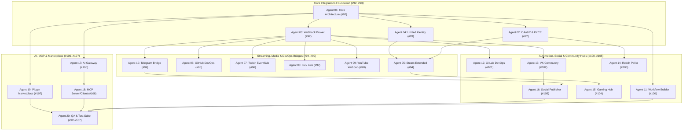

# Multi-Agent Engineering Roadmap: Phase 4 (20 Agents for Issues #92–#107)

This document formalizes the division of engineering responsibilities, architectural invariants, interface contracts, and acceptance criteria across **20 specialized autonomous agents**, covering all open GitHub issues ([#92 to #107](https://github.com/abanach-com/rust-discord-bot/issues)) for the **Rusty Discord Bot (`rusty-discord-bot`)** platform.

---

## 1. Global Architectural Invariants (Phase 4: Integrations & Extensibility)

Every agent must operate strictly within the following privileged boundary rules:

1. **Rust is the Privileged Host & Network Sentinel**: All outbound HTTP requests, webhook verifications, database transactions, OAuth exchanges, and process invocations belong exclusively to the Rust host. Direct OS or raw TCP/UDP calls are forbidden in userland.
2. **Strict SSRF Protection**: Outbound requests to provider endpoints must validate IP targets against private, loopback, link-local, and cloud metadata ranges (RFC 1918, RFC 3927, RFC 4193, RFC 4291). Hostnames are restricted to verified allowlists with DNS rebinding and redirect limits.
3. **Lua Sandbox Boundary**: Lua scripts never receive provider access tokens, client secrets, database connections, or direct HTTP sockets. Lua modules interact with integrations exclusively through declarative command and action descriptors validated by the Rust host.
4. **Snowflake Precision**: All Discord identifiers (`guild_id`, `channel_id`, `role_id`, `user_id`, `message_id`) and 64-bit external IDs (e.g. SteamID64) must be serialized as `String` across Lua, JSON, PostgreSQL, and dashboard boundaries.
5. **Raw Body Signature Verification**: All inbound webhooks (GitHub HMAC, Twitch EventSub, Kick, YouTube WebSub, Telegram Secret Token, VK Callback, GitLab Token) must verify signatures against the unmodified raw request body before parsing JSON payloads.
6. **Strict Idempotency & Deduplication**: Every event delivery is keyed by `(provider, event_id)` with persistent deduplication storage in PostgreSQL and in-memory caches to guarantee at-most-once processing.
7. **Secrets Encryption & Log Redaction**: Access tokens, refresh tokens, webhook secrets, and private keys must be encrypted at rest and masked in all logs, tracing spans, and error reports (`***REDACTED***`).
8. **Tenant & Multi-Guild Isolation**: Revoking or modifying an integration connection in one guild must have zero side effects on other guilds or users.

---

## 2. Multi-Agent Team Roster & Allocation (20 Agents)

| Agent | Codename | Primary Scope & Issue | Key Deliverables |
|---|---|---|---|
| **Agent 01** | `arch-orchestrator` | #92 Integration Core Contracts | Provider traits, event schema, capabilities registry, SSRF sentinel |
| **Agent 02** | `oauth-sentinel` | #92 OAuth2 & PKCE Manager | Authorization code flow, PKCE, state/nonce TTL, single-flight refresh |
| **Agent 03** | `webhook-broker` | #92 Webhook & Delivery Broker | Ingress gateway, raw body HMAC verifier, dedupe, circuit breaker |
| **Agent 04** | `identity-sync` | #93 Unified Identity | Multi-account links, proof-of-control, role sync, anti-hijack |
| **Agent 05** | `steam-bridge` | #94 Steam Extended | Steam OpenID, player summary, library, achievements, LFG |
| **Agent 06** | `github-devops` | #95 GitHub DevOps | GitHub App, push/PR/check-run webhooks, forum thread mapping, RBAC |
| **Agent 07** | `twitch-eventsub` | #96 Twitch Extended | EventSub transport, stream online/offline, live embeds, live roles |
| **Agent 08** | `kick-live` | #97 Kick Integration | Kick Dev API, webhook signature validation, livestream alerts |
| **Agent 09** | `youtube-websub` | #98 YouTube Extended | WebSub hub subscribe, upload/premiere/shorts heuristics, quota monitor |
| **Agent 10** | `telegram-relay` | #99 Telegram Bridge | Bot API webhook, secret token, bidirectional relay, anti-loop |
| **Agent 11** | `workflow-engine` | #100 Workflow Builder | Visual DAG engine, JSON schema validation, cycle detection, run ledger |
| **Agent 12** | `gitlab-devops` | #101 GitLab Integration | Gitlab.com & self-hosted allowlist, MR/pipeline hooks, CI retry |
| **Agent 13** | `vk-gateway` | #102 VK Integration | VK Callback API, confirmation challenge, post events, group safety |
| **Agent 14** | `reddit-poller` | #103 Reddit Integration | Official API OAuth, cursor polling, flair/keyword filter, mod dry-run |
| **Agent 15** | `gaming-hub` | #104 Gaming Hub | Aggregated games registry, PoE1 vs PoE2 separation, LFG, status |
| **Agent 16** | `social-publisher` | #105 Social Publisher | Multi-platform composer, scheduled delivery, approvals, retry |
| **Agent 17** | `ai-gateway` | #106 AI Gateway & Budget | Hard token budget, channel ACL document RAG, prompt injection defense |
| **Agent 18** | `mcp-supervisor` | #106 MCP Server/Client | Model Context Protocol tools allowlist, audit ledger, approvals |
| **Agent 19** | `marketplace-guard` | #107 Plugin Marketplace | Signed package manifest, SHA-256 verification, transactional install |
| **Agent 20** | `qa-verification` | #92–#107 QA & CI Sync | Full suite test verification, feature matrix sync, release audits |

---

## 3. Dependency Graph & Execution DAG

---

## 4. Detailed Specifications by Autonomous Agent

### Agent 01: Master Architect & Integration Core Contracts Orchestrator
- **GitHub Issue**: [#92 `[Integrations][P1] Integration Core + OAuth`](https://github.com/abanach-com/rust-discord-bot/issues/92)
- **Domain Mission**: Implements provider traits (`ProviderAdapter`, `ProviderCapability`, `ProviderEvent`, `ProviderAction`, `ConnectFlow`, `DeliveryReceipt`), provider registry, SSRF protection sentinel with private IP filters and DNS rebinding prevention, and versioned event metadata.
- **Key Files**: `src/integrations/mod.rs`, `src/storage/mod.rs`
- **Acceptance Criteria**:
  - Rejects private/loopback/cloud-metadata egress targets before HTTP connection.
  - Returns `CapabilityStatus::Unsupported` when a capability is not supported.

### Agent 02: OAuth2 & PKCE Security Token Lifecycle Manager
- **GitHub Issue**: [#92 `[Integrations][P1] Integration Core + OAuth`](https://github.com/abanach-com/rust-discord-bot/issues/92)
- **Domain Mission**: Implements OAuth2 Authorization Code flow with RFC 7636 PKCE (S256 code verifier/challenge), session state and nonce with TTL, one-time callback verification, and single-flight token refresh with jitter.
- **Key Files**: `src/integrations/oauth.rs`, `src/web/routes.rs`
- **Acceptance Criteria**:
  - Rejects expired state or state associated with another session.
  - Concurrent token refresh requests coalesce into a single HTTP roundtrip.

### Agent 03: Webhook Ingress Gateway, Signature Verifier & Delivery Broker
- **GitHub Issue**: [#92 `[Integrations][P1] Integration Core + OAuth`](https://github.com/abanach-com/rust-discord-bot/issues/92)
- **Domain Mission**: Secure ingress endpoint `/api/integrations/webhooks/:provider`, raw payload HMAC-SHA256 signature verification, deduplication against `(provider, event_id)`, exponential backoff retry with circuit breaker.
- **Key Files**: `src/integrations/webhook.rs`, `src/web/features.rs`
- **Acceptance Criteria**:
  - Raw body signature mismatch returns 401/403.
  - Replayed event IDs return 200 OK with deduplication without triggering downstream tasks.

### Agent 04: Unified Identity & Multi-Account Association Engine
- **GitHub Issue**: [#93 `[Integrations][P1] Unified Identity`](https://github.com/abanach-com/rust-discord-bot/issues/93)
- **Domain Mission**: Central identity linking (`discord_user_id`, `provider`, `provider_subject`) with guild/global scope, proof-of-control validation, role synchronization policies, and self-service unlink/export.
- **Key Files**: `src/storage/mod.rs`, `src/storage/memory.rs`, `src/storage/postgres.rs`, `scripts/unified_identity/`
- **Acceptance Criteria**:
  - Two Discord users cannot claim the exact same provider account within the same uniqueness policy.
  - Unlink immediately revokes synced roles without escalating hierarchy.

### Agent 05: Steam Extended & Gaming Identity Bridge
- **GitHub Issue**: [#94 `[Integrations][P1] Steam Extended`](https://github.com/abanach-com/rust-discord-bot/issues/94)
- **Domain Mission**: Steam OpenID assertion validation, SteamID64 persistence, player summary, games library and achievements with privacy-respecting filters, and LFG command suite.
- **Key Files**: `src/integrations/providers/steam.rs`, `scripts/steam_extended/`
- **Acceptance Criteria**:
  - Private libraries return a privacy notice rather than falsified or empty rankings.
  - Multi-guild Steam configurations are strictly isolated.

### Agent 06: GitHub DevOps & CI/CD Pipeline Automation
- **GitHub Issue**: [#95 `[Integrations][P1] GitHub DevOps`](https://github.com/abanach-com/rust-discord-bot/issues/95)
- **Domain Mission**: GitHub App installation tokens, push/PR/check-run/workflow webhooks, mapping PRs to Discord forum threads, write actions guarded by explicit RBAC and confirmation prompts.
- **Key Files**: `src/integrations/providers/github.rs`, `scripts/github_devops/`
- **Acceptance Criteria**:
  - Webhooks failing `X-Hub-Signature-256` are rejected.
  - Write actions are denied for actors lacking required repository roles.

### Agent 07: Twitch Extended & EventSub Stream Automation
- **GitHub Issue**: [#96 `[Integrations][P1] Twitch Extended`](https://github.com/abanach-com/rust-discord-bot/issues/96)
- **Domain Mission**: EventSub webhook subscription handler, webhook challenge response, HMAC verification, single-embed message update for live streams, and live role assignment.
- **Key Files**: `src/integrations/providers/twitch.rs`, `scripts/twitch_extended/`
- **Acceptance Criteria**:
  - Duplicate EventSub notification IDs do not post duplicate Discord announcements.
  - Stream offline events reconcile state even after bot restarts.

### Agent 08: Kick Platform Integration & Live Streaming Bridge
- **GitHub Issue**: [#97 `[Integrations][P1] Kick Integration`](https://github.com/abanach-com/rust-discord-bot/issues/97)
- **Domain Mission**: Kick Dev API client, live stream webhook receiver, signature authentication, live embed updates, and optional chat bridge gating.
- **Key Files**: `src/integrations/providers/kick.rs`, `scripts/kick_live/`
- **Acceptance Criteria**:
  - Invalid webhook signatures are blocked with 401 Unauthorized.
  - Missing chat scopes disable chat forwarding while keeping live notifications functional.

### Agent 09: YouTube Extended & WebSub Media Dispatcher
- **GitHub Issue**: [#98 `[Integrations][P1] YouTube Extended`](https://github.com/abanach-com/rust-discord-bot/issues/98)
- **Domain Mission**: WebSub (PubSubHubbub) feed subscriptions, upload/premiere/shorts classification heuristics, single embed per video tracking, quota conservation.
- **Key Files**: `src/integrations/providers/youtube.rs`, `scripts/youtube_extended/`
- **Acceptance Criteria**:
  - Multiple WebSub notifications for the same video produce exactly one post.
  - Quota exhaustion triggers safe circuit breaking without crash.

### Agent 10: Telegram Bidirectional Bridge & Anti-Loop Relay
- **GitHub Issue**: [#99 `[Integrations][P1] Telegram Bridge`](https://github.com/abanach-com/rust-discord-bot/issues/99)
- **Domain Mission**: Telegram Bot API webhook, secret token header check, bidirectional message synchronization, message ID mapping, mime allowlist, and anti-echo loop breaker.
- **Key Files**: `src/integrations/providers/telegram.rs`, `scripts/telegram_bridge/`
- **Acceptance Criteria**:
  - Relayed messages carry origin platform flags and never bounce back infinitely.
  - Deleting bridge configuration immediately halts relaying in both directions.

### Agent 11: Workflow Builder DAG Engine & Visual Automation
- **GitHub Issue**: [#100 `[Integrations][P1] Workflow Builder`](https://github.com/abanach-com/rust-discord-bot/issues/100)
- **Domain Mission**: Directed Acyclic Graph (DAG) workflow engine with node schema validation (trigger, condition, action, delay), cycle detection, dry-run evaluation, checkpoint history, and dead-letter queues.
- **Key Files**: `src/integrations/providers/workflow.rs`, `scripts/workflow_builder/`
- **Acceptance Criteria**:
  - Workflows containing cyclic dependencies are rejected during validation.
  - Dry-run mode evaluates execution flow without applying mutating actions.

### Agent 12: GitLab Cloud & Self-Hosted DevOps Integration
- **GitHub Issue**: [#101 `[Integrations][P2] GitLab`](https://github.com/abanach-com/rust-discord-bot/issues/101)
- **Domain Mission**: GitLab webhook processing for Push, Merge Request, Pipeline, and Job events. Support for gitlab.com and self-hosted instances with domain allowlist and SSRF guards.
- **Key Files**: `src/integrations/providers/gitlab.rs`, `scripts/gitlab_devops/`
- **Acceptance Criteria**:
  - Self-hosted targets pointing to internal or unapproved domains are rejected.
  - Repeated pipeline status events update the existing message without duplicate alerts.

### Agent 13: VKontakte (VK) Community & Callback API Gateway
- **GitHub Issue**: [#102 `[Integrations][P2] VK Integration`](https://github.com/abanach-com/rust-discord-bot/issues/102)
- **Domain Mission**: VK Callback API confirmation challenge handshake, secret key validation, wall post and comment notifications, isolated provider failure handling.
- **Key Files**: `src/integrations/providers/vk.rs`, `scripts/vk_community/`
- **Acceptance Criteria**:
  - Callback confirmation returns the designated confirmation string immediately.
  - Failure or rate limiting in the VK adapter does not affect any other integration.

### Agent 14: Reddit Official API & Community Poller
- **GitHub Issue**: [#103 `[Integrations][P2] Reddit`](https://github.com/abanach-com/rust-discord-bot/issues/103)
- **Domain Mission**: Official Reddit API OAuth client, subreddit polling with cursor pagination (`before`/`after`), flair and keyword filtering, NSFW policy enforcement, and moderator dry-run approvals.
- **Key Files**: `src/integrations/providers/reddit.rs`, `scripts/reddit_feed/`
- **Acceptance Criteria**:
  - First-time subscription respects backfill limits and avoids flooding channels.
  - Non-moderator accounts cannot trigger moderation actions.

### Agent 15: Gaming Hub Aggregator & PoE1/PoE2 Cross-Platform LFG
- **GitHub Issue**: [#104 `[Integrations][P2] Gaming Hub`](https://github.com/abanach-com/rust-discord-bot/issues/104)
- **Domain Mission**: Multi-game registry, Path of Exile 1 and Path of Exile 2 strict namespace and league separation, cross-platform LFG listings with TTL, and server availability monitors.
- **Key Files**: `src/integrations/providers/gaming_hub.rs`, `scripts/gaming_hub/`
- **Acceptance Criteria**:
  - PoE 2 league queries never return PoE 1 leagues or characters.
  - Expired LFG listings are purged lazily and never returned in searches.

### Agent 16: Social Publisher Multi-Platform Scheduler & Approval Engine
- **GitHub Issue**: [#105 `[Integrations][P2] Social Publisher`](https://github.com/abanach-com/rust-discord-bot/issues/105)
- **Domain Mission**: Cross-platform publication composer (Discord, Telegram, VK), multi-target delivery tracking, per-target error isolation, two-person approval gates, and scheduled dispatcher.
- **Key Files**: `src/integrations/providers/social_publisher.rs`, `scripts/social_publisher/`
- **Acceptance Criteria**:
  - Failure on one platform does not cause duplicate re-publication on successful platforms.
  - Unapproved drafts scheduled for release remain locked until approved.

### Agent 17: AI Gateway, Budget Controls & RAG Guard
- **GitHub Issue**: [#106 `[Integrations][P2] AI + MCP`](https://github.com/abanach-com/rust-discord-bot/issues/106)
- **Domain Mission**: Unified AI provider proxy with hard token and USD budget caps per guild, document-level channel ACLs for RAG retrieval, and prompt injection filtering.
- **Key Files**: `src/integrations/providers/ai_mcp.rs`, `scripts/ai_mcp/`
- **Acceptance Criteria**:
  - Exceeding the guild budget cap halts downstream model requests immediately.
  - RAG index retrieval filters out documents from channels inaccessible to the querying user.

### Agent 18: Model Context Protocol (MCP) Server/Client & Tool Registry
- **GitHub Issue**: [#106 `[Integrations][P2] AI + MCP`](https://github.com/abanach-com/rust-discord-bot/issues/106)
- **Domain Mission**: MCP tool discovery, strict tool allowlists, per-tool permission scopes, mutating action approval gates, and comprehensive invocation audit logs.
- **Key Files**: `src/integrations/providers/ai_mcp.rs`
- **Acceptance Criteria**:
  - Arbitrary shell or unrestricted filesystem tool executions are strictly prohibited.
  - Tool invocations with side effects require explicit human confirmation.

### Agent 19: Plugin Marketplace, Cryptographic Verification & Supply Chain
- **GitHub Issue**: [#107 `[Integrations][P2] Plugin Marketplace`](https://github.com/abanach-com/rust-discord-bot/issues/107)
- **Domain Mission**: SemVer package manifests, SHA-256 cryptographic package integrity verification, static Lua permission scan, transactional install/update/rollback, and per-plugin resource quotas.
- **Key Files**: `src/integrations/providers/marketplace.rs`, `scripts/plugin_marketplace/`
- **Acceptance Criteria**:
  - Tampered or unsigned packages with mismatched SHA-256 hashes are rejected.
  - Failed plugin upgrades roll back to the previously active version without data loss.

### Agent 20: Full-Suite Verification, Quality Assurance & Feature Matrix Synchronizer
- **GitHub Issue**: [#92–#107 Quality Assurance & Release Governance]
- **Domain Mission**: End-to-end integration test suite (`tests/phase4_suite.rs`), verifying AC-1 through AC-5 for every single issue (#92–#107), compilation, clippy audits, and updating `docs/FEATURE_MATRIX.md`.
- **Key Files**: `tests/phase4_suite.rs`, `docs/FEATURE_MATRIX.md`
- **Acceptance Criteria**:
  - 100% of integration test assertions pass cleanly under `cargo test`.
  - Feature matrix updated to reflect all 16 implemented integration tracks.
